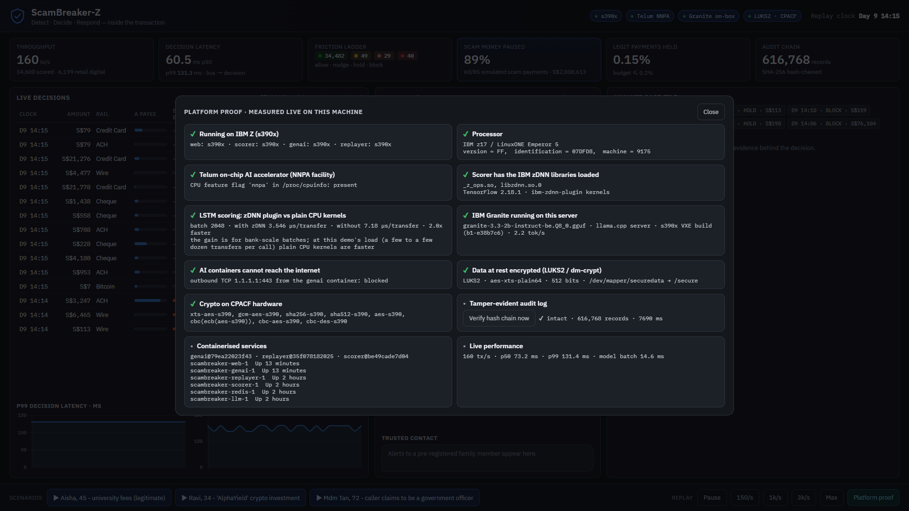
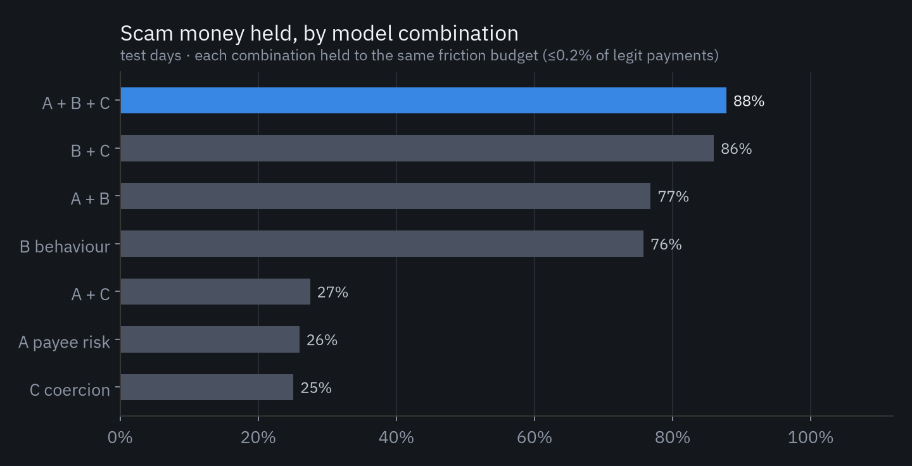
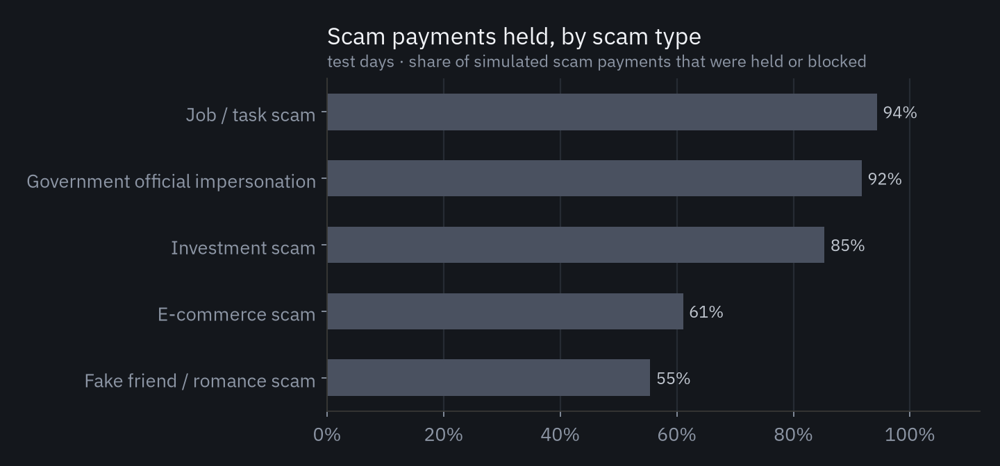

# Swaggers_IBM Z Datathon 2026 Project: ScamBreaker-Z

**Stopping scams inside the transaction, on IBM LinuxONE.**

Theme 1, *Real-time AI for Critical Decisions* (Detect. Decide. Respond.)

**Links:** 🎥 Demo video (link added after upload) · 🖥️ Live prototype: <http://148.100.76.147:8080/?code=kLuVhFogDDzi> · [Architecture](docs/architecture.md) ([PNG](docs/architecture.png)) · [Data card](docs/data_card.md) · [Results](#results) · [IBM Z evidence](#how-it-uses-ibm-z-and-linuxone) · [Screenshots](docs/evidence/screenshots/)

**Try the live prototype:** open <http://148.100.76.147:8080/?code=kLuVhFogDDzi> (the link fills in the demo code, `kLuVhFogDDzi`) and click a scenario in the bar at the bottom. The decision appears instantly; IBM Granite's messages then follow one by one over about 3 minutes on the VM's 3 vCPUs. The public demo replays AMLworld at 150 transfers a second so it can run until results day; the replay-speed buttons are for the team.

---

## The problem

- **Singapore lost S$913.1M to scams in 2025** across 37,308 scam cases ([SPF, Feb 2026](https://www.police.gov.sg/media-hub/police-life/2026/02/scams-and-cybercrime-fell-by-almost-a-quarter-in-2025); [SPF infographic](https://www.police.gov.sg/-/media/SPF/Media-Room/Statistics/Annual-Scams-and-Cybercrime-Brief-2025-Infographic/Infographic-for-ASCB-2025.pdf)).
- **In 2025, 81.8% of scams were self-effected (82.4% in 2024):** the victim was manipulated into sending the money themself ([SPF, Feb 2026](https://www.police.gov.sg/media-hub/police-life/2026/02/scams-and-cybercrime-fell-by-almost-a-quarter-in-2025)). Fraud models built to catch stolen cards and passwords see a genuine customer and stay silent.
- **Today's backstop is a police restriction order that freezes everything.** Only 12 were issued by Feb 2026. Graduated limits were shelved because banks said they need "significant system changes" ([MHA, 4 Mar 2026](https://www.mha.gov.sg/media-room/newsroom/restriction-orders-issued-under-protection-from-scams-act-2025/)).
- **Globally, about US$442B is lost to scams a year** ([GASA / Feedzai, Global State of Scams 2025](https://www.feedzai.com/global-state-of-scams-report-2025/)).

The only moment to act is between "Send" and settlement, and at most large banks that moment runs on IBM Z.

## What ScamBreaker-Z does

| | |
|---|---|
| **Detect** (milliseconds, every transfer) | Three specialist models score each payment in micro-batches: **A** payee mule risk (XGBoost, trained on IBM AMLworld's real laundering labels), **B** the customer's own behaviour (LSTM over their last 8 transfers, run on the Telum on-chip AI accelerator), and **C** coercion signals from the app session (on a call, payee added minutes ago, hesitation and more). |
| **Decide** | A calibrated stacker maps the evidence to a graduated **friction ladder: ALLOW · NUDGE · HOLD 24h · BLOCK + call-back**, within fixed budgets on legitimate payments (at most 1% nudged, 0.2% held, 0.05% blocked). |
| **Respond** (on-box generative AI) | **IBM Granite 3.3 2B**, served by llama.cpp on the same LinuxONE server, writes the warning in the customer's language (English and Chinese in the demo), an SMS to a trusted family member, and the analyst's case narrative, grounded in our policy and typology documents (BM25 RAG). Guardrails reject links, phone numbers or mismatched amounts and fall back to vetted templates. **The LLM explains decisions; it never makes them.** |

Three live scenarios, all with fictional people and a fictional "Demo Bank":
- **Mdm Tan, 72.** A caller posing as a government officer pushes her to move S$18,500 to a "safe account". The transfer is held or blocked in about 5 ms, and Granite warns her in English and Chinese and alerts her daughter.
- **Ravi.** A crypto "investment" asks for ever-bigger top-ups. The first payment is blocked, so the escalation never happens.
- **Aisha.** Genuine university fees to a new payee get only a gentle NUDGE (payee check), not a hold.

## How it uses IBM Z and LinuxONE

Everything below was measured on our LinuxONE Community Cloud VM: an **IBM z17** (machine type 9175) with Ubuntu 24.04, 3 vCPUs and 8 GB RAM.

| Capability | How ScamBreaker-Z uses it | Evidence |
|---|---|---|
| **Telum on-chip AI accelerator (NNPA)** | The behaviour LSTM runs through TensorFlow with IBM's `ibm-zdnn-plugin` (zDNN kernels). | Same model, same inputs: **3.55 µs vs 7.18 µs per transfer at batch 2048 (2.0×)** and 4.67 vs 9.72 µs at batch 512 (2.1×). The gain is for bank-scale batches: at 128 transfers per call or fewer, the plain CPU kernels are as fast or faster, and our live demo's calls are that small (a few to a few dozen transfers), so the demo itself does not run faster on the accelerator. A/B by hiding the plugin; `libzdnn.so.0` and `_z_ops.so` are verified mapped in the serving process. [chart](docs/results/nnpa_vs_cpu.png) |
| **IBM Z vector extensions (VXE)** | IBM Granite runs in a llama.cpp server we built for s390x with VXE enabled. | **5.0 tokens/s vs 1.35 tokens/s** for the prebuilt image's build without VXE (3.7×), for Granite 3.3 2B Q8_0 (big-endian GGUF). |
| **CPACF crypto + encryption at rest** | All data, models and the audit trail live on a **LUKS2 volume (AES-XTS, 512-bit key)**. The kernel uses the `xts-aes-s390` driver, i.e. the CPACF crypto unit. | `cryptsetup status`, `/proc/crypto` ([evidence](docs/evidence/)) |
| **Containers + isolation** | Docker Compose with six services. The AI services sit on an `internal` network **with no route to the internet**, run as non-root with all capabilities dropped and `no-new-privileges`. | Live check: an outbound connection from the Granite container fails ([evidence](docs/evidence/)) |
| **Tamper-evident audit** | Every non-ALLOW decision is appended to a SHA-256 hash-chained log; `verify` detects any edit. | Live "Platform proof" panel → *Verify hash chain now* |
| **Throughput and latency** | A point-in-time feature engine and the models in one stateful scorer, fed by Redis Streams. | One scorer process keeps p99 under 120 ms (bus to decision) at every sustained load we tested, from 500 to **4,020 transfers/s (p99 43 ms)**, and saturates near 5,200/s ([chart](docs/results/e2e.png)). Latency falls as load rises because micro-batches fill faster. The feature engine processes about 60K events/s; full training takes 203 s on 3 vCPUs. |

The console's **Platform proof** panel recomputes these facts live on the server (architecture, NNPA flag, loaded zDNN libraries, LUKS/CPACF, egress, audit chain). Nothing is hard-coded.



More screenshots: [LinuxONE portal](docs/evidence/screenshots/01_l1cc_portal.png) · [live console](docs/evidence/screenshots/03_console_live.png) · [terminal on the VM: s390x, z17, nnpa, containers](docs/evidence/screenshots/05_vm_terminal_cpu.png) · [LUKS2, CPACF, no egress, audit chain](docs/evidence/screenshots/04_vm_terminal.png)

## Results

All numbers are from **held-out test days (9 and 10 Sep 2022)**. Full output is in [`docs/results/metrics.json`](docs/results/metrics.json).

**Scam interception** on 1,000 simulated scam episodes (4,054 payments) injected into real AMLworld traffic, see the [data card](docs/data_card.md):

| | Result |
|---|---|
| Scam money held or blocked | **87.9%** |
| Scam payments held or blocked | 85.7% (97.0% get at least a nudge) |
| Scam episodes stopped | **90.1%**, median 0 payments before the first hold |
| Legitimate digital payments held | **0.20%** (budget 0.2%); nudged 1.0%; blocked 0.045% |
| Large first-time *genuine* payments (hard negatives) held | 29.8%: the hardest case, disclosed |



**Each model adds something:** behaviour alone holds 67% of scam money and coercion signals alone 48%; together they reach 88%. On real AMLworld labels the payee model reaches **AUPRC 0.32 against a 0.19% base rate (AUROC 0.95)**. Its main value is the back-office mule/AML flag; it adds about 0.2 points to scam decisions.



| Model | Test metric |
|---|---|
| A · payee mule risk (real labels) | AUPRC 0.318, AUROC 0.953, 62% recall at 1% FPR |
| B · behaviour LSTM | AUPRC 0.925, AUROC 0.997 (see limitations) |
| C · coercion | AUPRC 0.331, AUROC 0.942 |
| D · typology | 91.2% accuracy |
| Unseen-typology test (job scams removed from training) | 49% held vs 94% when seen |

## Responsible AI and limitations

- **The scam episodes are simulated.** Banks don't publish victim-side data, so episodes are injected into real IBM AMLworld histories and paid to real AMLworld mule accounts ([data card](docs/data_card.md)). The behaviour model's very high AUROC reflects how separable the simulated patterns are; a bank would refit on its own data.
- **We hunted for leakage and fixed what we found.** An early run let injected Bitcoin payments be cross-currency when no real one is, a synthetic fingerprint; that's now fixed. Hour of day is excluded from the behaviour and typology models because AMLworld spreads activity uniformly over 24 hours.
- **Known weak spots:** romance (55%) and e-commerce (61%) scams; 30% friction on large genuine first-time payments; reduced recall on scam types never seen in training.
- **The model decides, the LLM explains.** Prompts contain placeholders, never names or account numbers, and personal data is HMAC-tokenised. Every message passes guardrails, and generation falls back to vetted templates on any failure or timeout.
- **No protected attributes** (such as age) are model inputs. The persona's age appears only in the demo story.

## Run it

On a LinuxONE Community Cloud Ubuntu VM:
```bash
bash scripts/vm_bootstrap.sh            # Docker, firewall, packages
bash scripts/luks_setup.sh              # LUKS2 /secure volume (AES-XTS-512 on CPACF)
# put HI-Small_Trans.csv in /secure/work/raw, Granite BE GGUF in /secure/work/llm
IMG=registry.linuxone.cloud.marist.edu/l1cc/jupyterlab-image-s390x:latest
docker run --rm -u 1000 -v $PWD:/app -v /secure/work:/secure/work -w /app --entrypoint /opt/venv/bin/python $IMG \
  -m scambreaker.data.prep --csv /secure/work/raw/HI-Small_Trans.csv --out /secure/work/data
docker run --rm -u 1000 -v $PWD:/app -v /secure/work:/secure/work -w /app --entrypoint /opt/venv/bin/python $IMG \
  -m scambreaker.train --data /secure/work/data --models /secure/work/models --results /secure/work/results
echo "SB_DEMO_TOKEN=<secret>" > .env && docker compose up -d --build     # console on :8080
bash scripts/bench_all.sh && bash scripts/evidence.sh                   # benchmarks + evidence
```
For local development without LinuxONE: `python -m scambreaker.serve.allinone` runs everything in one process on an in-memory bus.

## Repository layout

| Path | What |
|---|---|
| `scambreaker/data/` | AMLworld loader, scam-episode injector, event-stream format |
| `scambreaker/features/engine.py` | Point-in-time feature engine, shared by training and serving (no train/serve skew) |
| `scambreaker/models/` | A (XGBoost), B (Keras LSTM), C (logistic regression), D (typology), stacker + friction policy |
| `scambreaker/serve/` | Scorer, replayer, Granite worker, guardrails, reason codes, web console, message bus |
| `scambreaker/security/` | HMAC tokenisation, hash-chained audit log |
| `scambreaker/bench/` | zDNN A/B, LLM and end-to-end benchmarks |
| `llm/Dockerfile` | llama.cpp server built for s390x with VXE |
| `knowledge/` | Typology playbooks, Demo Bank policy, Singapore regulation notes (RAG corpus) |
| `docs/` | Architecture, data card, results, evidence, lab outputs |
| `video/` | Reproducible video pipeline (slides, live recording, narration) |

## Open-source software, data and models

- **Data:** [IBM Transactions for Anti Money Laundering (AMLworld), HI-Small](https://www.kaggle.com/datasets/ealtman2019/ibm-transactions-for-anti-money-laundering-aml), from IBM Research (Altman et al., NeurIPS 2023).
- **LLM:** [IBM Granite 3.3 2B Instruct](https://huggingface.co/ibm-granite/granite-3.3-2b-instruct) (Apache-2.0); big-endian GGUF from [taronaeo/Granite-3.3-2B-Instruct-BE-GGUF](https://huggingface.co/taronaeo/Granite-3.3-2B-Instruct-BE-GGUF).
- **IBM Z:**
  - [LinuxONE Community Cloud ML image](https://github.com/linuxone-community-cloud/jupyter-lab-ml)
  - [ibm-zdnn-plugin](https://pypi.org/project/ibm-zdnn-plugin/)
  - [IBM zDNN](https://github.com/IBM/zDNN)
- **ML:**
  - [TensorFlow](https://github.com/tensorflow/tensorflow)
  - [Keras](https://github.com/keras-team/keras)
  - [XGBoost](https://github.com/dmlc/xgboost)
  - [scikit-learn](https://github.com/scikit-learn/scikit-learn)
  - [NumPy](https://github.com/numpy/numpy)
  - [pandas](https://github.com/pandas-dev/pandas)
  - [rank-bm25](https://github.com/dorianbrown/rank_bm25)
- **Serving:**
  - [llama.cpp](https://github.com/ggml-org/llama.cpp) (tag b6754)
  - [Flask](https://github.com/pallets/flask)
  - [Gunicorn](https://github.com/benoitc/gunicorn)
  - [Redis](https://github.com/redis/redis) 7.2
  - [redis-py](https://github.com/redis/redis-py)
  - [Requests](https://github.com/psf/requests)
  - [Docker](https://www.docker.com/)
- **UI and charts:**
  - [Chart.js](https://github.com/chartjs/Chart.js)
  - [Matplotlib](https://github.com/matplotlib/matplotlib)
  - [IBM Plex](https://github.com/IBM/plex) (OFL)
- **Video tooling:**
  - [Playwright](https://github.com/microsoft/playwright-python)
  - [edge-tts](https://github.com/rany2/edge-tts)
  - [FFmpeg](https://ffmpeg.org/) via [imageio-ffmpeg](https://github.com/imageio/imageio-ffmpeg)
  - [asciinema](https://github.com/asciinema/asciinema)

## Mandatory labs

Both IBM Z Datathon labs were run on our LinuxONE VM in the official image: *Predictive AI hybrid / multi-model* (Fraud LSTM, Churn with scikit-learn + PyTorch, Digit classification) and *Predictive + Generative AI* (Loan approval with XGBoost + Granite RAG). The executed notebooks and their HTML exports are in [`docs/evidence/labs/`](docs/evidence/labs/). A [platform-check notebook](docs/evidence/labs/00_platform_check_executed.ipynb), run in the same image on the same VM, prints `s390x`, machine type 9175 (IBM z17), the `nnpa` facility, TensorFlow 2.18.1 and ibm-zdnn-plugin 2.3.0.

## Team Swaggers

IBM Z Datathon 2026 · built 17–18 October 2026 on the IBM LinuxONE Community Cloud (event code SSF2026).
