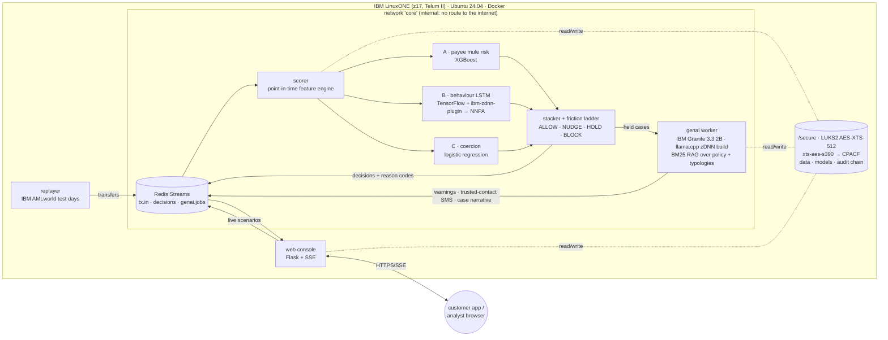

# Architecture

## Request path (one transfer)

1. **Ingest:** the transfer arrives on `tx.in`, which in production would be fed by the payment switch.
2. **Point-in-time features:** the scorer updates the sender's and payee's rolling state. The same code produced the training features, so there is no train/serve skew.
3. **Detect:** in one micro-batch,
   - **A** scores the payee's mule risk (fan-in, pass-through, account age),
   - **B** runs the LSTM over the customer's last 8 transfers through TensorFlow, where the ibm-zdnn-plugin places supported ops on the Telum on-chip AI accelerator,
   - **C** scores the app-session coercion signals.
4. **Decide:** a logistic stacker combines A, B and C. Thresholds fitted on validation days map the score to ALLOW / NUDGE / HOLD / BLOCK within fixed friction budgets.
5. **Respond:**
   - Held payments open a case with reason codes, using XGBoost's built-in TreeSHAP and the coefficients of the coercion model.
   - IBM Granite, running on the same box, writes the customer warning (in the customer's language), the trusted-contact SMS and the analyst narrative. The narrative is grounded in BM25-retrieved policy and typology excerpts.
   - Guardrails reject links, phone numbers and mismatched amounts, and fall back to vetted templates.
6. **Audit:** every non-ALLOW decision is appended to a SHA-256 hash-chained log on the encrypted volume.

## Why IBM Z / LinuxONE

- **The payments already run here.** Scoring inside the payment path removes a network hop to an external AI service, and Telum's on-chip accelerator is built for exactly this in-transaction inference.
- **Innovation without exposure.** The LLM, the models and the data stay on one box. The AI containers have no internet route, data at rest is encrypted by CPACF hardware, and prompts carry tokens, never names or account numbers.
- **Production path (not claimed as done here):**
  - IBM Secure Execution / Hyper Protect for confidential computing.
  - Crypto Express protected keys (`paes`) so the disk key never exists in the clear.
  - Horizontal partitioning of the stream by account, with a shared feature store.
